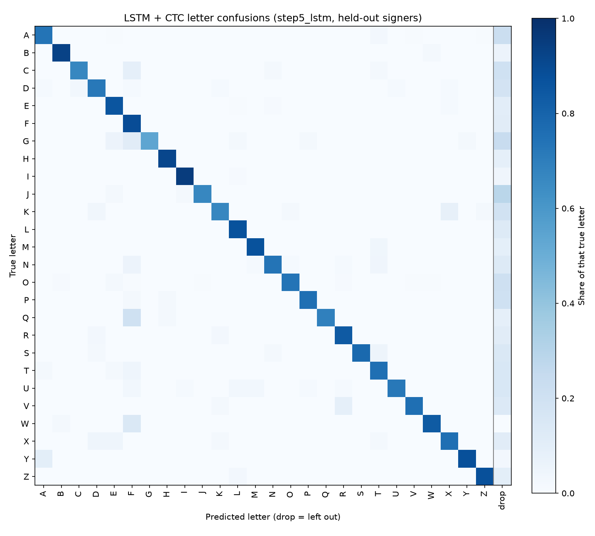

# Evaluation of `step5_lstm`

From the per-clip predictions in `results/step5_lstm.json` (2026-11-02, seed 0). Every prediction is on a held-out signer. 495 clips.

## CER by word length

| Letters | Clips | CER | Word acc | Letter recall |
|---|---|---|---|---|
| 2 | 27 | 48.1% | 33.3% | 72.2% |
| 3 | 135 | 29.9% | 32.6% | 75.6% |
| 4 | 126 | 27.6% | 31.0% | 80.2% |
| 5 | 117 | 25.1% | 24.8% | 80.2% |
| 6 | 72 | 21.5% | 30.6% | 83.1% |
| 7 | 9 | 20.6% | 33.3% | 79.4% |
| 8 | 9 | 23.6% | 0.0% | 77.8% |

## CER by signing speed

Speed = letters in the word / clip length (s), including the resting hand at the start and end. Clips are split into three equal groups.

| Group | Letters per second | Clips | CER | Word acc | Clips per signer |
|---|---|---|---|---|---|
| slow | 0.45–0.94 | 165 | 25.9% | 31.5% | anna 70, saaya 95 |
| medium | 0.94–1.22 | 165 | 16.3% | 43.0% | anna 88, saaya 64, thurushi 13 |
| fast | 1.22–2.73 | 165 | 37.1% | 13.9% | anna 7, saaya 6, thurushi 152 |

| Signer | Average letters per second |
|---|---|
| anna | 0.96 |
| saaya | 0.93 |
| thurushi | 1.65 |

## Letter confusions

Most common mistakes (true letter → what it became):

| True | Became | Times |
|---|---|---|
| O | (dropped) | 39 |
| A | (dropped) | 36 |
| E | (dropped) | 27 |
| L | (dropped) | 14 |
| T | (dropped) | 14 |
| D | (dropped) | 13 |
| G | (dropped) | 13 |
| J | (dropped) | 13 |
| K | (dropped) | 12 |
| U | (dropped) | 11 |
| C | (dropped) | 9 |
| N | (dropped) | 9 |
| P | (dropped) | 9 |
| Q | F | 9 |
| R | (dropped) | 9 |

Extra letters added (not in the word): F×30, L×14, Z×12, E×10, O×6, A×6, J×6, M×5, R×4, I×4.

## Inference time

One clip at a time on this computer's CPU, after the clip has ended (495 clips):

| Mean | Median | 95th percentile | Slowest | Real-time factor |
|---|---|---|---|---|
| 3.0 ms | 2.7 ms | 4.8 ms | 6.8 ms | 0.0008 |

Real-time factor = compute time / video length; below 1 means faster than real time. The LSTM is bidirectional, so it needs the whole word before it can answer: in the live app the delay is the time to the end of the word plus this inference time.
