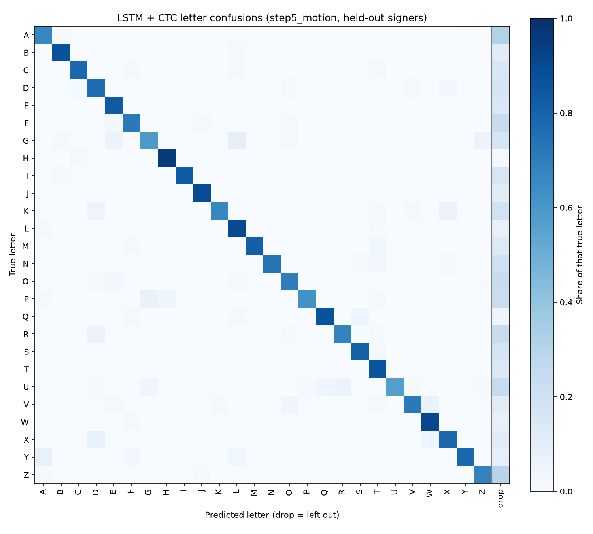

# Evaluation of `step5_motion`

From the per-clip predictions in `results/step5_motion.json` (2026-11-02, seed 0). Every prediction is on a held-out signer. 495 clips.

## CER by word length

| Letters | Clips | CER | Word acc | Letter recall |
|---|---|---|---|---|
| 2 | 27 | 33.3% | 44.4% | 81.5% |
| 3 | 135 | 36.5% | 27.4% | 75.8% |
| 4 | 126 | 34.7% | 21.4% | 75.2% |
| 5 | 117 | 31.8% | 15.4% | 77.6% |
| 6 | 72 | 27.5% | 19.4% | 76.6% |
| 7 | 9 | 25.4% | 22.2% | 74.6% |
| 8 | 9 | 22.2% | 0.0% | 80.6% |

## CER by signing speed

Speed = letters in the word / clip length (s), including the resting hand at the start and end. Clips are split into three equal groups.

| Group | Letters per second | Clips | CER | Word acc | Clips per signer |
|---|---|---|---|---|---|
| slow | 0.45–0.94 | 165 | 29.6% | 29.1% | anna 70, saaya 95 |
| medium | 0.94–1.22 | 165 | 21.9% | 30.9% | anna 88, saaya 64, thurushi 13 |
| fast | 1.22–2.73 | 165 | 45.0% | 6.7% | anna 7, saaya 6, thurushi 152 |

| Signer | Average letters per second |
|---|---|
| anna | 0.96 |
| saaya | 0.93 |
| thurushi | 1.65 |

## Letter confusions

Most common mistakes (true letter → what it became):

| True | Became | Times |
|---|---|---|
| A | (dropped) | 50 |
| O | (dropped) | 45 |
| E | (dropped) | 37 |
| Z | (dropped) | 24 |
| I | (dropped) | 20 |
| R | (dropped) | 19 |
| U | (dropped) | 17 |
| F | (dropped) | 15 |
| N | (dropped) | 15 |
| T | (dropped) | 13 |
| D | (dropped) | 12 |
| K | (dropped) | 12 |
| S | (dropped) | 11 |
| P | (dropped) | 10 |
| G | (dropped) | 9 |

Extra letters added (not in the word): F×62, O×20, Z×16, L×15, A×10, W×10, B×9, R×8, S×6, E×5.

## Inference time

One clip at a time on this computer's CPU, after the clip has ended (495 clips):

| Mean | Median | 95th percentile | Slowest | Real-time factor |
|---|---|---|---|---|
| 2.0 ms | 1.8 ms | 3.3 ms | 4.5 ms | 0.0005 |

Real-time factor = compute time / video length; below 1 means faster than real time. The LSTM is bidirectional, so it needs the whole word before it can answer: in the live app the delay is the time to the end of the word plus this inference time.
