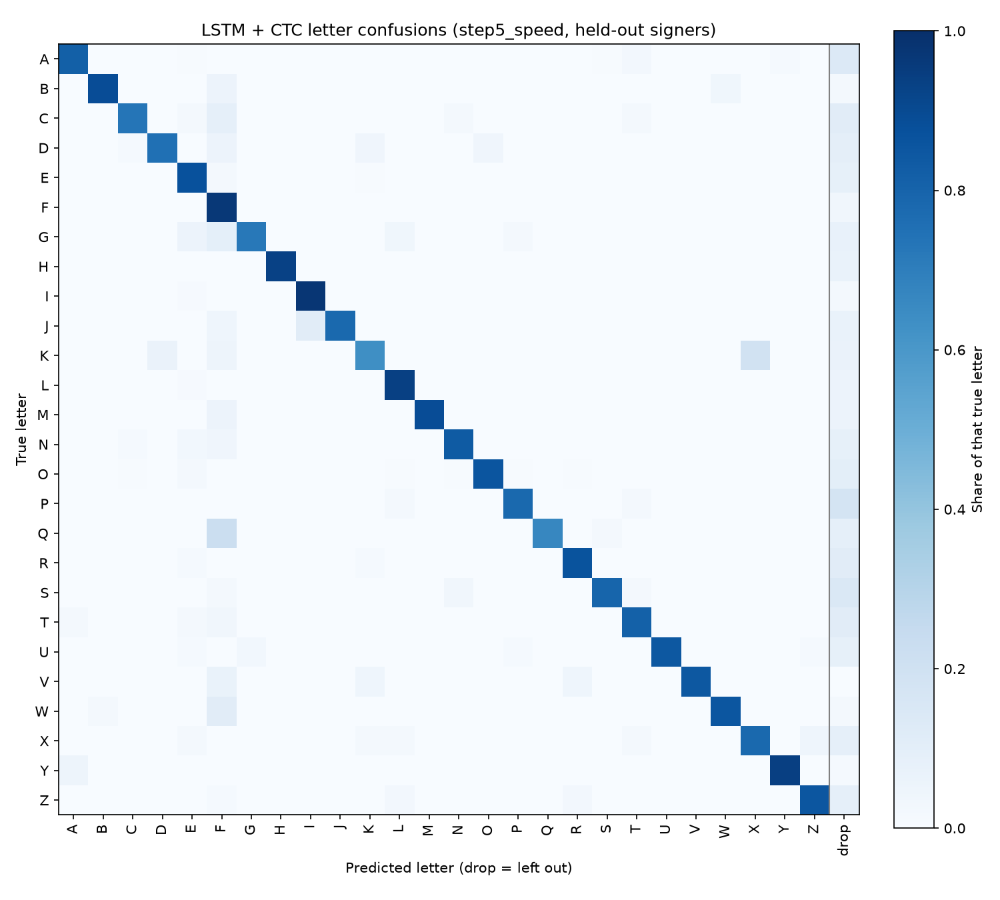

# Evaluation of `step5_speed`

From the per-clip predictions in `results/step5_speed.json` (2026-11-03, seed 0). Every prediction is on a held-out signer. 495 clips.

## CER by word length

| Letters | Clips | CER | Word acc | Letter recall |
|---|---|---|---|---|
| 2 | 27 | 38.9% | 48.1% | 83.3% |
| 3 | 135 | 20.5% | 49.6% | 84.4% |
| 4 | 126 | 21.8% | 46.8% | 85.7% |
| 5 | 117 | 19.7% | 29.9% | 85.1% |
| 6 | 72 | 18.1% | 33.3% | 85.0% |
| 7 | 9 | 23.8% | 11.1% | 76.2% |
| 8 | 9 | 20.8% | 0.0% | 79.2% |

## CER by signing speed

Speed = letters in the word / clip length (s), including the resting hand at the start and end. Clips are split into three equal groups.

| Group | Letters per second | Clips | CER | Word acc | Clips per signer |
|---|---|---|---|---|---|
| slow | 0.45–0.94 | 165 | 21.6% | 42.4% | anna 70, saaya 95 |
| medium | 0.94–1.22 | 165 | 15.5% | 43.6% | anna 88, saaya 64, thurushi 13 |
| fast | 1.22–2.73 | 165 | 25.1% | 34.5% | anna 7, saaya 6, thurushi 152 |

| Signer | Average letters per second |
|---|---|
| anna | 0.96 |
| saaya | 0.93 |
| thurushi | 1.65 |

## Letter confusions

Most common mistakes (true letter → what it became):

| True | Became | Times |
|---|---|---|
| A | (dropped) | 22 |
| E | (dropped) | 22 |
| O | (dropped) | 19 |
| K | X | 12 |
| Q | F | 10 |
| T | (dropped) | 10 |
| R | (dropped) | 9 |
| S | (dropped) | 9 |
| P | (dropped) | 8 |
| D | (dropped) | 7 |
| Z | (dropped) | 7 |
| L | (dropped) | 6 |
| N | (dropped) | 6 |
| U | (dropped) | 6 |
| W | F | 6 |

Extra letters added (not in the word): F×49, Z×22, J×5, K×5, A×4, L×4, P×3, O×3, I×3, B×3.

## Inference time

One clip at a time on this computer's CPU, after the clip has ended (495 clips):

| Mean | Median | 95th percentile | Slowest | Real-time factor |
|---|---|---|---|---|
| 1.7 ms | 1.5 ms | 2.8 ms | 3.9 ms | 0.0004 |

Real-time factor = compute time / video length; below 1 means faster than real time. The LSTM is bidirectional, so it needs the whole word before it can answer: in the live app the delay is the time to the end of the word plus this inference time.
